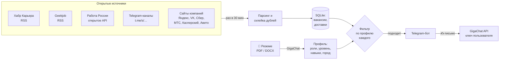
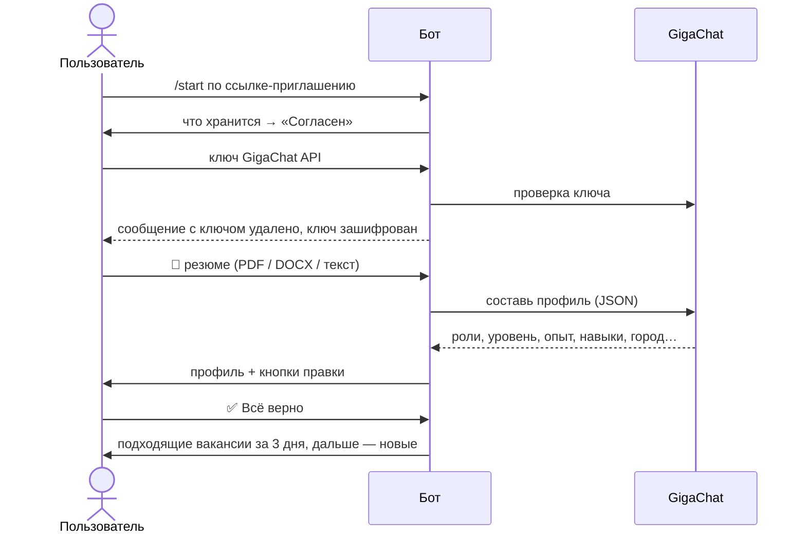

<h1 align="center">🔎 job-watch</h1>

<p align="center">
  <b>Telegram-бот, который сам ищет IT-вакансии под твоё резюме и пишет сопроводительные письма</b>
</p>

<p align="center">
  <a href="https://github.com/RealPycuk/job-watch/actions/workflows/ci.yml"></a>
  
  
  
  
  
  <a href="LICENSE"></a>
</p>

---

Раз в полчаса бот собирает свежие вакансии из агрегаторов, Telegram-каналов и карьерных сайтов IT-компаний (Яндекс, VK, Сбер, МТС, Касперский, Авито), отсеивает неподходящие по роли, уровню, опыту, городу и зарплате и присылает карточку: что из требований у тебя уже есть, чего не хватает, ссылка. По кнопке — сопроводительное письмо, которое **GigaChat** пишет по тексту вакансии и твоему резюме.

Бот работает для нескольких людей: каждый приходит по приглашению, присылает своё резюме и получает вакансии под свой профиль.

## Как выглядит

```text
💼 Junior DevOps Engineer  junior
🏢 Example Tech · 📍 СПб · удалённо · 💰 от 120 000 ₽
🧩 Совпадает: Linux, Docker, CI/CD, Prometheus
➕ Не хватает: Terraform, GitLab CI
✉️ hr@example.tech · @example_recruiter
🔗 https://career.habr.com/vacancies/...
Хабр Карьера

[ ✍️ Сопроводительное ] [ 📄 Текст ]
[ ⭐ Сохранить ]        [ 🙈 Скрыть ]
```

## Как устроено



Источники опрашиваются **один раз на всех**, а фильтр работает отдельно для каждого пользователя — нагрузка почти не растёт с их числом.

## Источники

Только открытые форматы — без обхода защит и без сбора с сайтов, которые это запрещают.

| Источник | Как читается | Особенность |
|---|---|---|
| **Хабр Карьера** | RSS по поисковым запросам | запросы = роли всех пользователей |
| **Geekjob** | RSS всех вакансий | лента — невалидный XML, разбирается устойчивым парсером |
| **Работа России** | открытое API trudvsem.ru | опыт и удалёнка — из структурированных полей |
| **Telegram-каналы** | публичная веб-версия `t.me/s/<канал>` | 10 каналов с вакансиями DevOps/IT, список в `config.toml` |

**Карьерные сайты компаний** — то, что сайты сами отдают браузеру без авторизации; опрашиваются раз в 3 часа:

| Компания | Как читается |
|---|---|
| **Яндекс** | JSON `yandex.ru/jobs/api/publications`, поиск по тексту |
| **VK** | JSON `team.vk.company/career/api/v2/vacancies` — все вакансии по 50 за запрос, фильтр у себя |
| **Сбер** | IT-вакансии с `developers.sber.ru` (данные страницы Next.js) |
| **МТС** | JSON `job.mts.ru/api/v2/vacancies`, фильтр по названию |
| **Лаборатория Касперского** | HTML-список вакансий, первые 3 страницы (их `/api/` закрыт в robots.txt — не используется) |
| **Авито** | HTML IT-категорий; город и удалёнка дочитываются со страницы вакансии (schema.org JobPosting), если она прошла фильтр |

Не подключены: Ozon и ЭР-Телеком — сайты закрыты антибот-защитой, обходить её проект не будет; Альфа-Банк и Т-Банк не отвечают на запросы с зарубежных IP; у Норбита своих вакансий на сайте нет.

Если источник не отвечает 3 раза подряд, владельцу приходит предупреждение, а потом — сообщение, что источник ожил.

## Что умеет фильтр

| | Правило |
|---|---|
| 🧭 **Роль** | по ключевым словам из профиля; в RSS и API — только в заголовке, в Telegram-постах — в начале текста |
| 📈 **Уровень** | для junior отсекаются senior, lead, head, architect, «ведущий», «сеньор»; для middle — только руководящие |
| ⏳ **Опыт** | «от 3 лет», `5+ years of experience` и поле из API сравниваются с опытом кандидата |
| 🏙 **Город и формат** | в своём городе — выбранные форматы (офис / гибрид / удалёнка), в других городах — только удалёнка; «удалёнка не рассматривается» тоже понимает |
| 💰 **Зарплата** | если рублёвая вилка ниже минимума из профиля — пропуск; без зарплаты вакансия проходит |
| 🚫 **Шум** | посты-резюме (`#резюме`, «ищу работу») и дубли одной вакансии из разных источников |
| 🧩 **Навыки** | что из вакансии уже есть в профиле, а чего не хватает |
| ✉️ **Контакты HR** | почта из текста вакансии и контактов «Работы России»; в Telegram-постах — ещё ники из строк «Контакты: …», «Пишите: …» |

## Регистрация пользователя



Ответ модели не принимается на веру: каждое поле проверяется и приводится к допустимым значениям, навыки берутся только из известного списка.

## Безопасность и данные

- **Доступ по приглашению:** владелец открывает его командой `/invite <id>` или одноразовой ссылкой `/invite` (7 дней); остальным бот показывает их ID и больше ничего не делает.
- **Ключи GigaChat** пользователей хранятся зашифрованными (Fernet, AES-128 + HMAC), сообщение с ключом сразу удаляется из чата, в логи ключи не пишутся.
- **GigaChat** использует сертификаты удостоверяющего центра Минцифры. Его корневой сертификат лежит в `certs/` (SHA-256 `D2:6D:2D:02:…:CA:8E:CF:31`) и включается **только** для запросов к GigaChat — все остальные соединения проверяются обычным набором сертификатов.
- **Контейнер:** не root, read-only файловая система, `cap_drop: ALL`, `no-new-privileges`, лимит памяти 128 МБ, ни одного открытого порта.
- `/delete` удаляет всё о пользователе: профиль, резюме, ключ и историю.

## Команды

| Пользователь | | Владелец | |
|---|---|---|---|
| `/profile` | профиль и фильтры | `/invite [id]` | открыть доступ / ссылка-приглашение |
| `/saved` | сохранённые вакансии | `/revoke <id>` | закрыть доступ и удалить данные |
| `/status` | статистика за неделю | `/users` | кто пользуется и сколько получил |
| `/pause`, `/continue` | пауза рассылки | `/check` | проверить источники сейчас |
| `/cv` | загрузить новое резюме | | |
| `/key` | сменить ключ GigaChat | | |
| `/delete` | удалить мои данные | | |

## Запуск

```bash
git clone https://github.com/RealPycuk/job-watch.git && cd job-watch
cp .env.example .env                 # BOT_TOKEN, OWNER_ID, GIGACHAT_AUTH_KEY, JOBWATCH_SECRET
cp profile.example.md profile.md     # факты о владельце для писем (не коммитится)
python -c "from cryptography.fernet import Fernet; print(Fernet.generate_key().decode())"   # → JOBWATCH_SECRET
docker compose up -d --build
```

Фильтры владельца, поисковые запросы, Telegram-каналы и словарь навыков — в `config.toml`; он монтируется в контейнер, менять можно без пересборки.

## Тесты

```bash
python -m unittest discover -s tests -v
```

63 теста, CI гоняет их на каждый push вместе с flake8, hadolint и сборкой образа:

- разбор **настоящих** сохранённых ответов каждого источника и сайта компании (`tests/fixtures`, чужие контакты заменены заглушками);
- правила фильтрации для разных профилей: город, форматы, уровень, опыт, зарплата;
- многопользовательский цикл: каждому — своё, без повторов и дублей, пауза, первый запуск без лавины сообщений;
- миграция БД со старой схемы, одноразовость приглашений, шифрование ключей, разбор резюме и ответа модели;
- клиент GigaChat против локального сервера (токен кэшируется, правильные заголовки);
- **сквозной сценарий регистрации** через настоящий диспетчер aiogram: от приглашения до первой вакансии.

## Стек

Python 3.12 · aiogram 3 · aiohttp · aiosqlite · BeautifulSoup · pypdf · cryptography · GigaChat API · Docker Compose · GitHub Actions

## Лицензия

[MIT](LICENSE)
